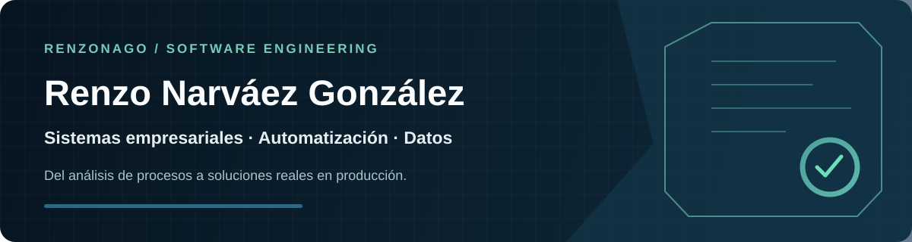
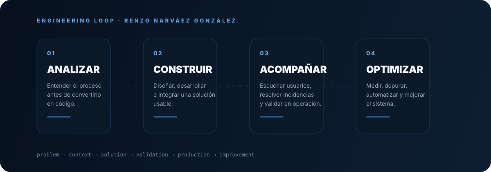

### Ingeniero en Sistemas Computacionales · Full Stack & Software Empresarial

**Analizo procesos, construyo soluciones y acompaño su operación.**

  
  
  

---

## Ingeniería aplicada a problemas reales

Soy **Renzo Narváez González**, ingeniero en Sistemas Computacionales. Mi experiencia está en el punto de encuentro entre **desarrollo de software, procesos operativos, datos y personas**.

He trabajado en el ciclo completo de soluciones empresariales: **entender necesidades, modelar información, desarrollar, implementar, capacitar usuarios, resolver incidencias y mejorar el sistema en producción**. Me interesa tanto la calidad técnica de una solución como el cambio que produce en la operación diaria.

> **Mi enfoque:** no automatizar por automatizar, sino eliminar pasos innecesarios, preservar la consistencia de los datos y entregar herramientas que la gente realmente pueda utilizar.

## Experiencia en números

<table>
<tr>
<td align="center" width="25%"><h3>+200,000</h3><b>registros</b> Depurados y migrados en entornos empresariales.</td>
<td align="center" width="25%"><h3>1 clic</h3><b>reporte de servicio</b> Generación automatizada desde el flujo de mantenimiento.</td>
<td align="center" width="25%"><h3>ERP</h3><b>en producción</b> Módulos para servicios, inventario, ventas y administración.</td>
<td align="center" width="25%"><h3>+2,000</h3><b>diseños ganaderos</b> Procesados para comparación visual con IACOW.</td>
</tr>
</table>

## Experiencia destacada

### 01 / ERP JCB AZTECA — JVJ Technology

**Desarrollador Full Stack** · Diciembre 2024 – Octubre 2026 · Villahermosa, Tabasco

Participé en el análisis, desarrollo y evolución de un **ERP utilizado en la operación diaria**, integrando procesos de servicios técnicos, almacén, ventas y administración.

| Reto operativo | Solución desarrollada |
|:--|:--|
| Mantenimientos documentados mediante WhatsApp y herramientas separadas | Flujo integrado de tickets, presupuestos, refacciones, agenda, asignación de técnicos y evidencias, con **reporte PDF generado desde el sistema mediante un botón**. |
| Diferencias en existencias y reportes históricos | Diagnóstico y corrección de lógica de inventario, consultas y reglas relacionadas con movimientos, cancelaciones, clasificaciones y periodos. |
| Información dispersa y registros de distintas fuentes | Depuración, estructuración y **migración de más de 200,000 registros**, incluidos inventarios, clientes, unidades y documentación fiscal XML/CFDI. |
| Seguimiento operativo manual y poca visibilidad consolidada | Tableros, indicadores y reportes para **servicios, ventas, almacén e inventario**, junto con integraciones y automatizaciones. |
| Necesidades cambiantes después del despliegue | **Soporte técnico y funcional, diagnóstico de incidencias, mejoras continuas y capacitación** a usuarios del ERP. |

**Tecnologías empleadas:** `PHP` · `Laravel` · `JavaScript` · `MySQL` · `SQL` · `APIs REST` · `XML/CFDI` · `PDF`

El sistema es de uso empresarial. Comparto el contexto y las soluciones implementadas sin publicar código ni información confidencial.

### 02 / IACOW — Asociación Ganadera Local de Macuspana

**Desarrollador Full Stack** · Enero – Noviembre 2024 · Macuspana, Tabasco

Desarrollé un sistema web para **gestión de socios y comparación visual de fierros ganaderos**, con procesamiento de más de 2,000 diseños. Incorporé procesamiento de imágenes, emisión de credenciales y automatización de tareas administrativas.

**Tecnologías:** `Python` · `Django` · `PostgreSQL` · `Procesamiento de imágenes`

**Reconocimiento:** proyecto presentado en la **etapa nacional de INNOVATECNM 2024**.

## Proyectos y evidencia

<table>
<tr>
<td width="50%" valign="top">
<strong>ERP JCB AZTECA</strong> 
Sistemas empresariales, automatización de reportes, inventario, analítica y soporte.  
<a href="https://renzonago.github.io/site/projects/jcb/">Ver caso de estudio →</a>
</td>
<td width="50%" valign="top">
<strong>IACOW</strong> 
Gestión ganadera, comparación visual, procesamiento de imágenes y automatización.  
<a href="https://renzonago.github.io/site/projects/iacow/">Ver caso de estudio →</a>
</td>
</tr>
</table>

## Tecnologías y áreas de trabajo

| Área | Herramientas y experiencia |
|:--|:--|
| **Backend** | PHP, Laravel, Python, Django, APIs REST, JSON |
| **Frontend** | JavaScript, HTML, CSS, Bootstrap; React y TypeScript en proyectos actuales |
| **Bases de datos** | MySQL, PostgreSQL, MariaDB, SQLite, diseño de esquemas y consultas SQL |
| **Datos y automatización** | Depuración y migración, XML/CFDI, reportes PDF, indicadores/KPIs, integraciones |
| **Ingeniería y operación** | Git/GitHub, análisis de requerimientos, depuración, pruebas, soporte y capacitación |
| **IA aplicada** | Análisis técnico, exploración de soluciones, revisión de lógica y apoyo a la documentación |

## Mi proceso de trabajo

**El sistema no termina cuando se despliega.** La retroalimentación del usuario, la integridad de los datos y los incidentes de operación forman parte del trabajo de ingeniería.

## Hacia dónde estoy evolucionando

Estoy profundizando en **ingeniería de datos, automatización e IA aplicada al desarrollo**, con interés en soluciones integradas, arquitecturas modulares, SQL avanzado y sistemas que puedan crecer sin perder claridad operativa.

Actualmente también desarrollo proyectos con **React, TypeScript, Laravel y PostgreSQL**. Distingo entre tecnologías que he aplicado profesionalmente y las que sigo aprendiendo en proyectos propios.

## Formación y contacto

**Ingeniería en Sistemas Computacionales** · Instituto Tecnológico Superior de Macuspana (2024)  
**Técnico en Informática** · Instituto de Difusión Técnica N.º 7  
**Inglés:** B1

**Disponible para colaborar en desarrollo backend, sistemas empresariales, automatización y soluciones orientadas a datos.**

[Portafolio](https://renzonago.github.io/site/) · [LinkedIn](https://www.linkedin.com/in/renzo-narvaez) · [GitHub](https://github.com/RenzoNaGo) · [Correo](mailto:renzonago09@gmail.com)

Villahermosa, Tabasco, México · Perfil actualizado en noviembre de 2026

